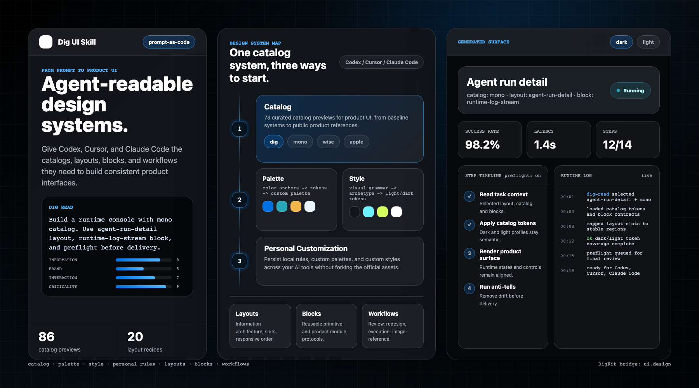
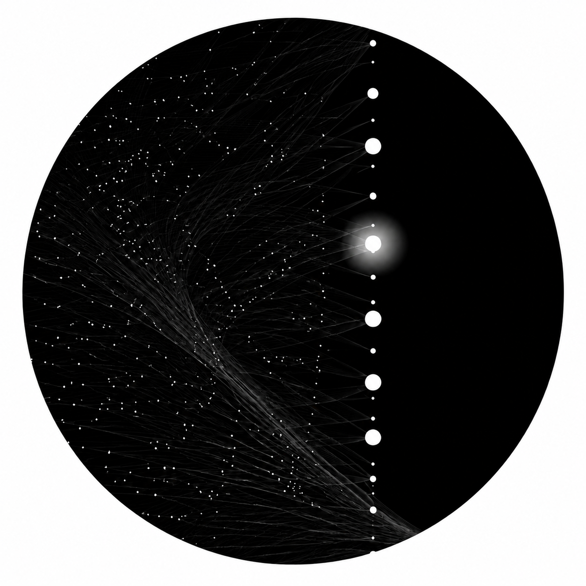
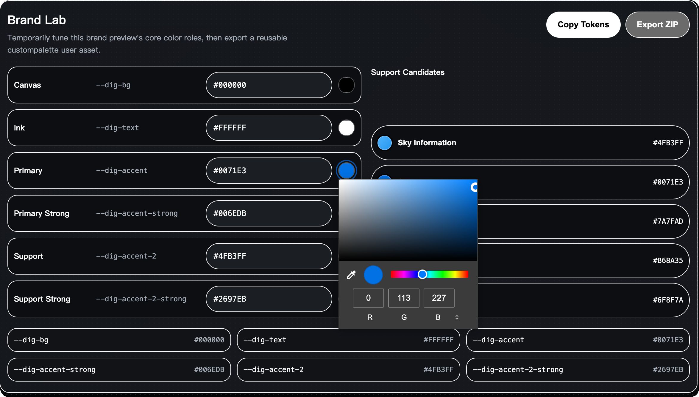
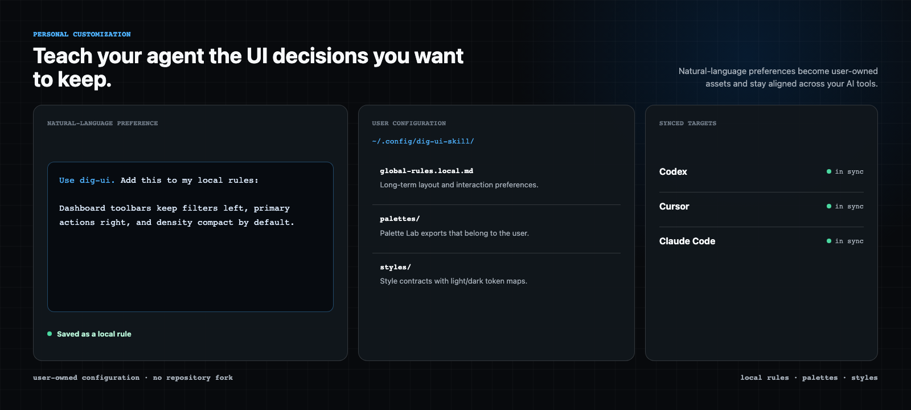
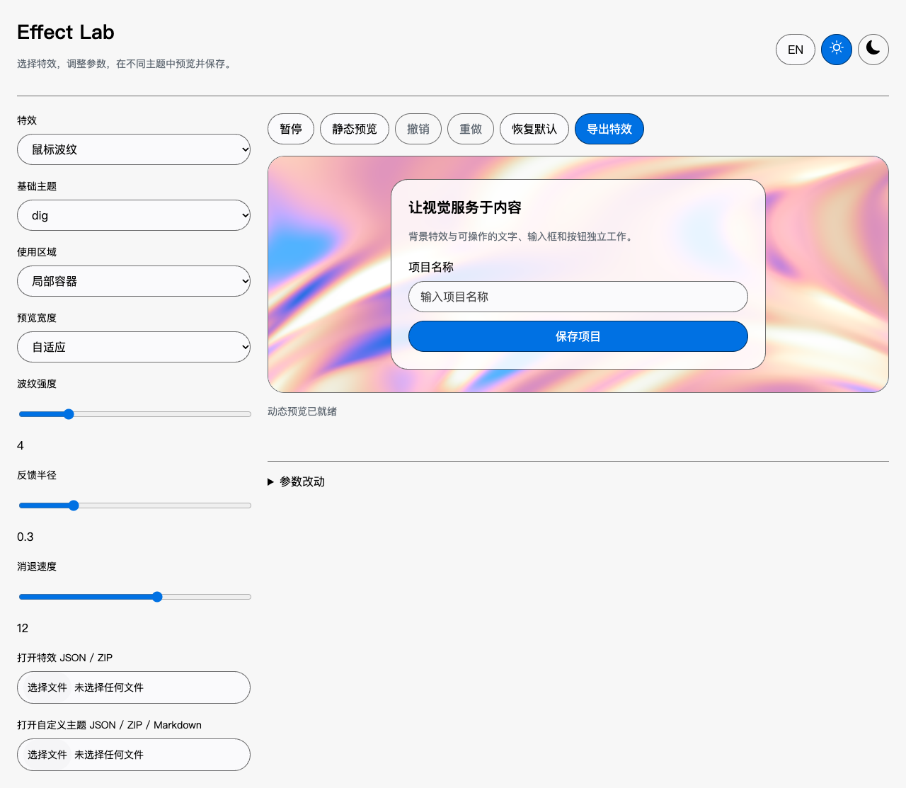
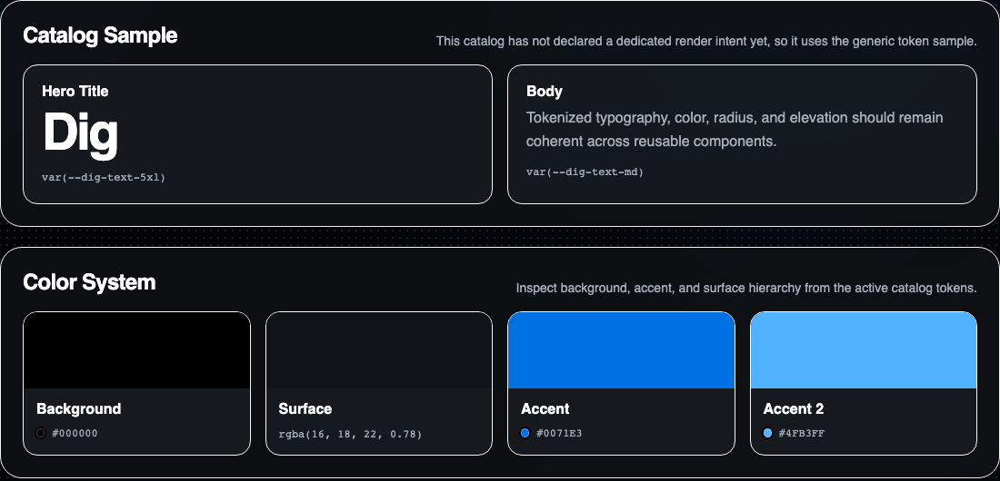
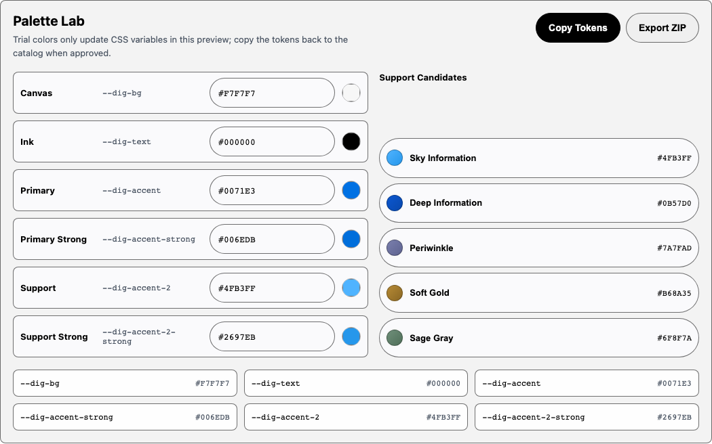
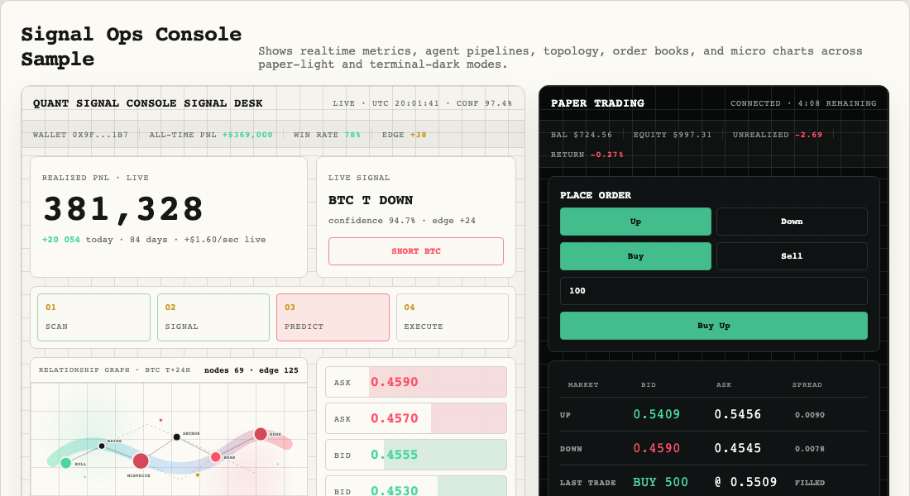

<p align="center">
  
</p>

<h1 align="center">Dig UI Skill</h1>

<p align="center">
  面向产品 UI 的 Agent 可读设计系统。
</p>

<p align="center">
  一条命令，让 Codex、Cursor 和 Claude Code 拥有一套可持续使用的 UI 设计语言。
</p>

<p align="center">
  <a href="./README.md">English</a> ·
  <a href="./INSTALL.zh-CN.md">安装指南</a> ·
  <a href="./USAGE.zh-CN.md">使用指南</a> ·
  <a href="./renders/index.html">Catalog 预览</a> ·
  <a href="#shaders-effects">Shaders 特效</a> ·
  <a href="#personal-customization">个人定制</a> ·
  <a href="#你可以构建什么">你可以构建什么</a>
</p>

<p align="center">
  <a href="./LICENSE"></a>
  <a href="https://www.npmjs.com/package/dig-ui-skill"></a>
  
  
  
</p>

<p align="center">
  
</p>

Dig UI Skill 是面向 AI 编程 Agent 的 prompt-as-code 设计系统。它不是传统的组件库；它为 Agent 提供 catalog、layout recipe、block contract、workflow、本地扩展规则和可视化预览，让产品界面能稳定地延续同一种设计语言。

```text
Catalog 提供品味。
Palette 与 Style 提供扩展性。
个人规则提供所有权。
Layout 与 Block 提供结构。
Shaders 特效让动态与材质跨视觉系统复用。
Workflow 让过程可以重复。
```

## 快速开始

安装到一个 AI 工具：

```bash
npx dig-ui-skill install codex
npx dig-ui-skill install cursor
npx dig-ui-skill install claude-code
```

安装到所有支持的工具并查看状态：

```bash
npx dig-ui-skill install --all
npx dig-ui-skill status
```

在对话中这样使用：

```text
使用 Dig UI。先阅读 references/dig-read.md，使用 dashboard-overview layout，
应用 dig catalog，并在交付前执行 preflight。
```

选择安装语言：

```bash
npx dig-ui-skill install codex --lang zh-CN
npx dig-ui-skill install codex --lang en
```

在 WorkBuddy 中使用请参阅 [WorkBuddy 使用](#workbuddy-使用)。

安装与更新详见[安装指南](./INSTALL.zh-CN.md#installation)。

## 新增 Shaders 支持

<a href="https://shaders.com/"></a>

使用 Shaders 为任意 catalog 添加流动渐变、网点、噪声、光晕和鼠标反馈，并在 Effect Lab 中预览、调参和导出复用。

运行以下命令生成预览，再通过本地开发服务打开：

```bash
npx dig-ui-skill effect preview flowing-ribbon --output ./effect-lab.html
```

<a href="https://github.com/shader-effects-inc/shaders" style="color: #0071e3;">Shaders GitHub</a> [](https://github.com/shader-effects-inc/shaders) · [使用说明](#shaders-effects)

## 新增 Style

<table align="center">
  <tr>
    <td align="center" colspan="3">
      <a href="./renders/styles/monochrome.html"></a>
      <h3>Monochrome<br>单色</h3>
    </td>
  </tr>
  <tr>
    <td align="center">
      <a href="./renders/styles/hologram-moire.html"></a>
      <h3>Hologram<br>全息</h3>
    </td>
    <td width="168" aria-hidden="true">&nbsp;</td>
    <td align="center">
      <a href="./renders/styles/cyberpunk-neon.html"></a>
      <h3>Cyberpunk<br>赛博</h3>
    </td>
  </tr>
</table>

在 Prompt 中写，“**使用 Monochrome Style**”、“**使用全息 Style**”或“**使用赛博 Style**”，Agent 会按对应视觉语法生成页面。

## 即时试色与导出

点一下颜色格就能直接预览整页，满意后即可导出为自己的 Style 或 Palette。

<p align="center">
  
</p>

<a name="personal-customization"></a>

## 100% 个人定制

让 Agent 记住你希望长期保留的 UI 判断。Dig UI Skill 会将自然语言偏好沉淀为用户拥有的规则、palette 与 style，并在 Codex、Cursor 和 Claude Code 之间保持一致。

<p align="center">
  
</p>

| 保留 | 拥有 | 同步 |
| --- | --- | --- |
| 需要持续生效的 layout、密度、层级和交互偏好。 | 仓库外的 `global-rules.local.md`、custom palette 与 custom style。 | 将同一份个人资产同步到每个已安装的 AI 工具。 |

两种 Local Rules 入口最终都写入同一个用户配置真源：

```text
~/.config/dig-ui-skill/global-rules.local.md
```

### 1. 你已有一份 `global-rules.local.md`

导入已有 Markdown 文件，再显式同步到已安装工具：

```bash
npx dig-ui-skill local import --from ./global-rules.local.md
npx dig-ui-skill local sync --all --from-config
```

### 2. 你可以直接使用自然语言让 Codex 帮你添加

直接向任意兼容的 Host Agent 描述想长期保留的判断：

```text
使用 dig-ui。把这条加入我的 local rules：
默认主强调色使用蓝色 #0071e3，主按钮使用白色文字。
```

Local 自定义规则详见[使用文档](./USAGE.zh-CN.md#local-rules)。

## 你可以构建什么

| 你的目标 | Dig UI Skill 会帮助你 | 从这里开始 |
| --- | --- | --- |
| 审查已有 UI | 检查 layout 一致性、catalog 匹配度、缺失状态、响应式行为和常见 AI UI 漂移。 | `references/workflows/review.md` |
| 生成产品 dashboard | 选择 layout recipe，应用 catalog，使用 block contract，并运行 preflight。 | `references/layouts/dashboard-overview.md` |
| 构建 agent/runtime 执行界面 | 使用 execution workflow、日志 block、步骤时间线和高密度操作型表面。 | `references/layouts/agent-run-detail.md` |
| 定制色彩系统 | 从 palette catalog 开始，通过 Palette Lab 导出并同步 custom palette。 | `references/catalogs/palettes/` |
| 沉淀完整视觉语法 | 导出 style contract，并同步为本地 custom style。 | `references/catalogs/styles/` |
| 添加动态背景与鼠标反馈 | 选择 Shaders 组件、调整 recipe，并绑定现有 catalog 与主题。 | [Shaders 使用指南](./USAGE.zh-CN.md#shaders-effects) |
| 教会 Agent 你的 UI 偏好 | 在仓库外持久化 local global rules、palette 和 style。 | `references/local-rules-builder.md` |

## 核心系统

| 层级 | 职责 | 入口 |
| --- | --- | --- |
| **Dig Read** | 任务的第一轮判断、资产选择与产品 dials。 | `references/dig-read.md` |
| **Catalog** | 73 套产品 UI 视觉语言：token、排版、surface、组件、密度和气质。 | `references/catalogs/` |
| **Palette** | 颜色优先的定制、Palette Lab 与可导入的 palette contract。 | `references/catalogs/palettes/` |
| **Style** | 完整视觉语法、render archetype、双主题 token 与 custom style 导出。 | `references/catalogs/styles/` |
| **Layouts** | 信息架构、slot、响应式顺序与 QA notes。 | `references/layouts/` |
| **Blocks** | 可复用 primitive 与产品模块的行为 contract。 | `references/blocks/` |
| **Effects** | 可选的 Shaders 组合、主题绑定、挂载和静态降级，跨 catalog 复用。 | `references/effects/` |
| **Workflows** | 可重复的 review、redesign、execution 与 image-reference 流程。 | `references/workflows/` |
| **Preflight** | 对状态、结构、catalog 选择和反模式的交付 gate。 | `references/preflight.md` |

<a name="shaders-effects"></a>
<a name="effects--特效"></a>

## Shaders 特效

使用 Shaders 为页面添加流动渐变、网点、噪声、光晕和鼠标反馈。Dig UI 通过独立 Effects 配置层，将这些组件绑定到现有 catalog token，并统一处理挂载、暂停恢复、静态降级和资源释放：

```text
Layout + 一个基础 catalog + Blocks + 可选 Effects
```

同一份特效可以搭配 brand、palette、style 及个人主题。当前内置 **Shaders 4.0.4**，提供原生 JavaScript 和 React 接入。

| 试用 recipe | Shaders 组件 | 可调参数 |
| --- | --- | --- |
| `flowing-ribbon` | FlowingGradient | 速度、扰动、形态变化 |
| `dot-field` | DotGrid | 密度、网点大小、速度 |
| `cursor-ripples` | FlowingGradient + CursorRipples | 强度、半径、衰减 |
| `soft-grain` | SimplexNoise | 尺度、对比度 |
| `radial-halo` | RadialGradient | 半径 |

<p align="center">
  
</p>

打开双语 [Effect Lab](./renders/effects/index.html)，选择 recipe、调整已声明参数、切换主题，再导出可继续编辑的 ZIP。自定义组件组合通过 recipe JSON 编写，Lab 负责预览并展示配置声明的参数控件。

生成预览并将特效安装到应用项目：

```bash
npx dig-ui-skill effect preview flowing-ribbon --output ./effect-lab.html
npx dig-ui-skill effect install flowing-ribbon --project ./my-app
```

通过项目本地开发服务在 localhost/HTTPS 下打开预览，以使用 WebGPU。减少动态效果、暂停或 GPU 不可用时，装饰层静态降级，正文和控件仍可操作。导出包包含本地 provider；React 由宿主应用提供。Effects 命令从 `dig-ui-skill` 1.1.0 起提供；本地开发时可用 `node bin/dig-ui-skill.mjs` 替换 npm 入口。

组件组合、JS/React 接入、主题绑定、导出与维护见 [Shaders 使用指南](./USAGE.zh-CN.md#shaders-effects)；配置与生命周期细节见 [Effects 协议](./references/effects/README.md)。

## Catalogs

每个页面或组件组只选择一套基础 catalog。Catalog 提供成熟的产品 UI 语言，Palette 从颜色关系切入，Style 则携带完整的视觉语法。

Catalog、Palette 与 Style 的选择详见[使用文档](./USAGE.zh-CN.md#architecture-workflow)。

### Catalog

<p align="center">
  
</p>

当你已有成熟产品界面、已知视觉语言，或需要可靠默认基线时，从这里开始。Catalog 是 Agent 可读的设计 contract，不是照抄用的截图，也不是要导入的组件包。

**包含：**73 套产品 UI catalog，覆盖 AI、SaaS、金融科技、开发工具、DevOps、创意工具、电商、媒体、汽车与 Dig 基础风格。可以从 `dig`、`mono`、`wise`、`apple` 开始，并在 [`renders/index.html`](./renders/index.html) 浏览完整预览。

**如何定制：**保留内置 catalog 作为视觉基线，再通过 local global rules、layout 和 block 加入项目约束。个人偏好应放入 local assets，而不是 fork 一套官方 catalog。

### Palette

<p align="center">
  
</p>

当颜色关系是主要决策时，从这里开始：锚点色、现有色板、整体氛围或站点级颜色系统。

**包含：**内置 palette catalog 与 Palette Lab；它将 canvas、ink、primary、support 和语义角色映射为可用的 Dig token。

**如何定制：**在 Palette Lab 调整锚点色，导出 `custompalette`，再导入并同步到各工具：

```bash
npx dig-ui-skill palette import ~/Downloads/palette01.custompalette.zip codex
npx dig-ui-skill palette list
npx dig-ui-skill palette sync --all
```

用户 palette 保存在 `~/.config/dig-ui-skill/palettes/`，同步到 `references/local/palettes/`，不会改动内置 catalog 集。

Palette 详见[使用文档](./USAGE.zh-CN.md#palette)。

### Style

<p align="center">
  
</p>

当你需要的不只是主题色时，从这里开始。Style 会将材质选择、surface 行为、组件气质、render archetype 和完整 light/dark token contract 一起带入任务。

**包含：**15 套内置视觉语法，包括 `cozy-arcade`、`quant-signal-console`、`cyberpunk-neon`、`hologram-moire`、`business-editorial`、`research-lab` 与 [Monochrome 单色](./renders/styles/monochrome.html)。[style 路由指南](./references/catalogs/styles/README.md) 会按任务和 avoid boundary 帮助选择基础 style。

**如何定制：**Style Lab 可分别在 Light / Dark 下临时调整六个核心颜色角色；导出时两套 token 会一起写入 `customstyle`，再导入并同步到各工具：

```bash
npx dig-ui-skill style import ~/Downloads/quant-signal-console.customstyle.zip codex
npx dig-ui-skill style list
npx dig-ui-skill style sync --all
```

用户 style 保存在 `~/.config/dig-ui-skill/styles/`，同步到 `references/local/styles/`。它们始终是用户资产，不会成为内置 catalog 条目。

每个品牌 catalog 页面也提供 Brand Lab，使用同一套临时调色控件，并导出与既有 import / sync 流程兼容的 `custompalette`。

Style 详见[使用文档](./USAGE.zh-CN.md#style)。

## Layout 与 Blocks

Catalog 定义外观，layout 定义结构，block 定义可重复的 UI 行为。

Dig UI Skill 包含 **20 套 layout recipe**，覆盖 dashboard、docs、runtime console、table workspace、settings form、onboarding、pricing、search、auth 和 marketing 页面。

Block 覆盖基础控件和产品模块：

```text
button, input, select, tooltip, modal, tabs
table-toolbar, runtime-log-stream, run-status-header
step-timeline, settings-row, notification-item, search-result-row
```

核心路径：

```text
references/layouts/
references/blocks/
references/shared/layout-manifest.yaml
references/shared/block-manifest.yaml
```

Layout 与 Block 详见[使用文档](./USAGE.zh-CN.md#layouts-blocks)。

## Workflows

Workflow 让 Dig UI Skill 不只是静态资产库，而是一套可重复的 Agent 工作方式。

```text
references/workflows/review.md
references/workflows/redesign.md
references/workflows/execution.md
references/workflows/image-reference.md
references/anti-tells.md
references/preflight.md
```

它们支持审查既有 UI、在保留业务含义的前提下重新设计界面、构建 execution/runtime 页面、从视觉参考翻译实现，并在交付前过滤常见 AI UI 漂移。

Workflow 详见[使用文档](./USAGE.zh-CN.md#architecture-workflow)。

## 在 AI 工具中使用

### Codex

```bash
npx dig-ui-skill install codex
```

```text
使用 dig-ui skill。按照 Dig catalog 和 dashboard-overview layout 审查这个页面。
```

### Cursor

```bash
npx dig-ui-skill install cursor
npx dig-ui-skill install cursor --project /path/to/your/repo
```

```text
使用 Dig UI。将 references/layouts/settings-form.md 和 references/catalogs/other/dig.md 应用到这个界面。
```


```bash
npx dig-ui-skill install claude-code
npx dig-ui-skill install claude
```

```text
使用 Dig UI 重构这个界面。从 runtime-console layout 开始，并应用 mono catalog。
```

### WorkBuddy 使用

导出一个可直接上传的自包含技能包：

```bash
npx dig-ui-skill export workbuddy
```

默认生成 `~/.config/dig-ui-skill/dig-ui-workbuddy.zip`，包含所选语言和当前个人资产。打开 WorkBuddy 后，选择「技能 → 添加技能 → 上传技能」并选择该 ZIP；再次运行命令会直接覆盖它。

如需自定义输出位置或导出英文包，请参阅[安装指南中的 WorkBuddy 说明](./INSTALL.zh-CN.md#workbuddy)。

## 示例

审查一个 UI：

```text
使用 Dig UI。用 references/workflows/review.md、references/layouts/settings-form.md 和 references/catalogs/other/dig.md 审查这个 settings 页面。
```

生成运行界面：

```text
使用 Dig UI。使用 agent-run-detail layout、mono catalog、run-status-header、step-timeline 和 runtime-log-stream blocks 构建 agent 运行详情页。
```

定制个人品味：

```text
使用 Dig UI。添加一条 local rule：dashboard toolbar 默认保持紧凑，filter 在左，primary action 在右。
```

## 仓库结构

```text
dig-ui-skill/
├── SKILL.md                         # 供 Codex 兼容工具使用的 skill 入口
├── references/
│   ├── global-rules.md              # 跨 catalog 行为规则
│   ├── dig-read.md                  # Agent 任务判断与产品 dials
│   ├── catalogs/                    # Catalog、palette 与 style 资产
│   ├── layouts/                     # Layout recipe
│   ├── blocks/                      # Primitive 与产品 block contract
│   ├── effects/                     # Shaders recipe 与 Effects 协议
│   ├── workflows/                   # 可重复的 Agent workflow
│   ├── local/                       # 项目级扩展
│   ├── anti-tells.md                # 常见 AI UI 漂移过滤器
│   └── preflight.md                 # 交付 gate
├── renders/                         # Catalog 预览与独立 Effect Lab
├── assets/                          # README 资源、预览 CSS 与打包的 Effects runtime
├── adapters/                        # 工具适配器与 React DigEffect wrapper
├── agents/                          # Agent 元数据
└── bin/dig-ui-skill.mjs             # 安装与同步 CLI
```

## 开发

安装依赖：

```bash
npm install
```

同步 catalog 预览：

```bash
./sync-renders.sh
```

校验 catalog 预览：

```bash
npm run validate:catalogs
npm run validate:renders
```

构建并验证 Shaders recipe、provider 和 Lab：

```bash
npm run build:effects
npm run validate:effects
npm run test:effects:browser
```

开发时从当前仓库作为安装源：

```bash
node bin/dig-ui-skill.mjs install cursor --source .
node bin/dig-ui-skill.mjs install --all --source .
```

## 参与贡献

本仓库正在为公开开源做准备。在专门的 `CONTRIBUTING.md` 落地前，请保持改动小而易审查，并明确遵守 source-of-truth 边界：

- Catalog 描述视觉语言与 token。
- Layout 描述信息架构与 slot。
- Block 描述可复用 UI 行为 contract。
- Effects 描述 Shaders 组合与运行策略，独立于 catalog 选择。
- Workflow 描述可重复的 Agent 流程。
- 用户 palette、style、effect 与个人规则保留在官方资产集之外。

## 开源说明

Catalog 文件记录的是从公开产品界面抽象出的设计语言观察和规则。产品名、Logo 与商标均归各自权利人所有；本项目与这些公司不存在隶属、背书或赞助关系。

贡献 catalog 时，请提供设计系统分析，而不是复制专有资产。不要提交私有品牌文件、授权字体、截图、机密设计 token 或未经授权的品牌资产。

## 许可证

本项目采用 [Apache License 2.0](./LICENSE)。

打包的 Shaders 软件采用 MIT 许可，导出包保留其许可证与第三方声明。五个 recipe 为 Dig 原创组合；外部 presets 和用户资源需另行记录来源与授权。
